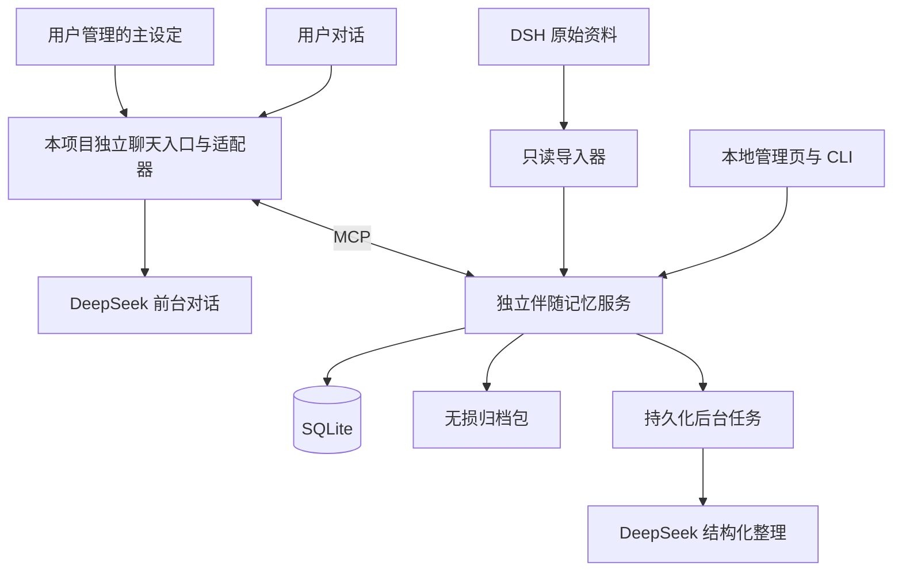
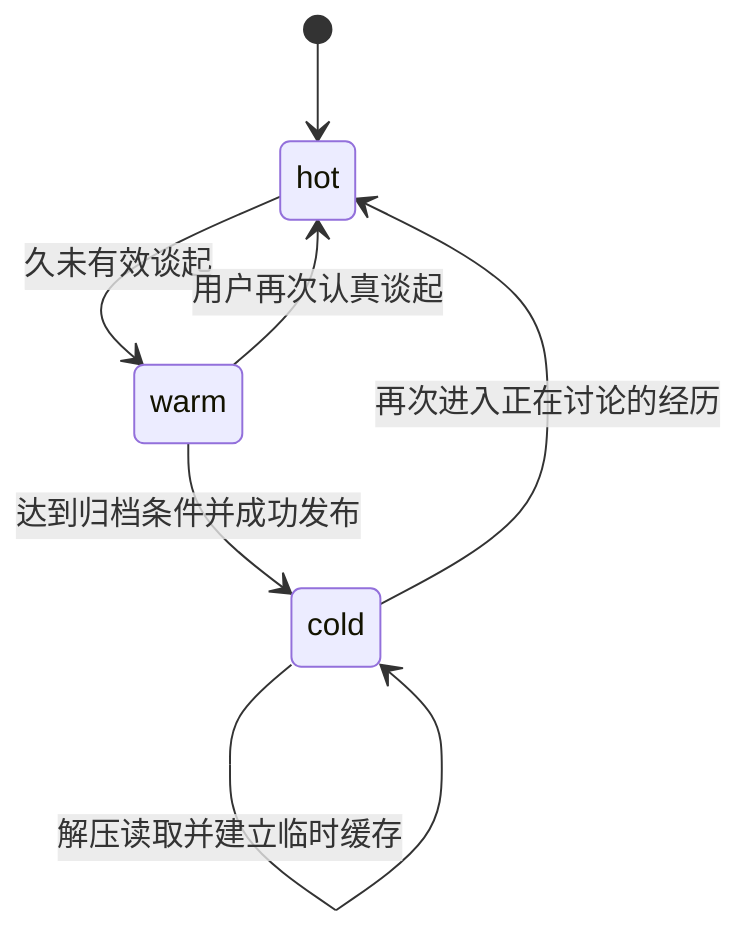

# 独立伴随记忆服务开发方案

文档版本：1.2
更新日期：2026-10-30

项目基线：`dsh-fish-memory` 1.4.3

实施状态：阶段一契约与合成样本、阶段二独立运行及存储基础已实现；MCP、模型整理、归档唤醒等后续阶段尚未实现

本项目拟新增独立运行的伴随记忆服务，让一个由 DeepSeek 驱动的角色逐渐了解用户的经历、感受和交流方式。记忆能够随着上下文发展重新整理，久远内容可以无损压缩并保留检索目录，在相关话题出现时自动唤醒。

角色主设定、主性格和主记忆继续独立管理。独立聊天入口由本项目提供，角色由用户自行定义和逐步培养，不再以接入第三方人物仓库为前提。伴随记忆保存理解用户所需的历史背景，不能通过自动记忆更新改写角色身份或人物设定。

本文整合当前已确认的需求，是后续开发、接口设计、数据迁移和验收的共同依据。此前讨论过的多家模型协作、多客户端各自建立 AI 私有记忆、依赖 DSH 常驻等方向不属于本次实施范围。

阶段一的具体字段、Schema、调用权限、序列化与迁移草案见 [阶段一契约与验收](../standalone/docs/阶段一契约与验收.md)，检查入口见 [独立契约包](../standalone/README.md)。本方案的产品边界不变；阶段一进一步明确临时回应需要的独立版本、统一结果包裹和字节与码点的计数方式。

## 1 需求等级与适用范围

全文采用以下约定，便于后续开发区分需求与实施参数。

| 等级 | 含义 | 变更方式 |
| --- | --- | --- |
| 已确认需求 | 用户已经确认的产品行为和边界 | 修改前重新说明影响，取得用户对方向的确认 |
| 工程契约 | 为落实已确认需求制定的完整性和一致性要求 | 可以调整实现，但必须保持对应行为与验收保证 |
| 建议默认值 | 初版用于开发和样本验证的参数 | 可配置，经测试校准，不等于用户已指定数值 |
| 待定接入项 | 需要目标仓库或实际运行条件才能确定的内容 | 保留适配边界，不据此编造支持能力 |

首版按一个用户、一个角色、一个 DeepSeek 连接配置设计。保留稳定 ID 以便追溯，但不预先建设多租户、多角色社交关系或多模型路由系统。

2026-10-30 用户调整：不接入第三方人物聊天仓库，开发自己的独立聊天入口；保留 MCP 作为服务边界和可选接入方式。主设定由用户明确管理，对话和整理均使用 DeepSeek。后续真实测试使用本项目入口，不依赖未知外部宿主。每阶段必须验证、提交并推送到用户当前远程仓库，确认远程提交及阶段标签后才能开始下一阶段；推送失败时保留本地成果并停止跨阶段推进。

## 2 已确认的目标

1. 服务独立运行，正常使用不要求启动或安装 DSH。
2. 前台角色和后台整理均使用 DeepSeek；后台任务不产生另一个人物身份。
3. MCP 用于连接独立聊天入口与记忆服务，并保留标准客户端接入能力。
4. 逐渐记住用户经历、当时感受、事情后续以及有依据的交流习惯。
5. 多轮上下文可以改变对同一段经历的理解，允许回头修订概要、情绪和交流意图。
6. 情绪理解逐渐清晰时，角色能够自然调整回应，例如减少急于解决问题的建议、先倾听倾诉。
7. 伴随记忆不改写主设定、主性格和主记忆。
8. 久远记忆降低日常出现频率，但不因衰减而自动丢失原文。
9. 到达归档条件后，无损压缩完整资料，继续保留概要与检索索引。
10. 之后再次提到相关事情时，自动查找、解压并使用最新有效理解。
11. 导入旧 DSH 记忆，保留原件，区分用户、原 AI 和第三方人物。
12. 支持用户纠正和撤回，旧任务、旧索引、旧导入与旧归档不能恢复已作废的理解。

基础存储、检索、索引与压缩不依赖模型。自动抽取、意图理解、复杂人物整理和概要修订使用后台 DeepSeek 调用，因此会产生额外模型用量；应提供任务合并、预算和暂停开关。

“不完全忘记”在本方案中指不因时间衰减而自动删除内容，且可以核验归档完整性。它不等于保证任何模糊提示都能检索成功，也不替代备份对磁盘损坏、误操作的保护。

## 3 系统边界与不变量

| 编号 | 必须保持的约束 |
| --- | --- |
| INV-01 | 记忆服务没有写入角色主设定、主性格或宿主主记忆的接口 |
| INV-02 | 原始消息、来源版本与已发布归档不可原地改写；修订另存 |
| INV-03 | 原话、事件事实、情绪推断和交流偏好分别保存，不把推断包装成用户明示 |
| INV-04 | 事件时间、表达时间、记录时间和修订时间分别保存 |
| INV-05 | 后来的情绪不自动倒写成前面所有回合的情绪 |
| INV-06 | 本次倾诉或建议需要不自动上升为长期偏好 |
| INV-07 | 后台结果必须校验基础版本、输入版本和撤回水位，旧结果不能覆盖新纠正 |
| INV-08 | 同一来源回合和同一写入请求重复提交不产生重复消息或重复记忆 |
| INV-09 | 归档包校验成功并发布引用之前，不能释放唯一可用的完整内容 |
| INV-10 | 尘封数据参与目录检索；读取内容后仍须叠加修订并检查撤回状态 |
| INV-11 | 注入的记忆和助手自己的推测不能作为用户新陈述重复记入 |
| INV-12 | 导入器只读原 DSH 文件；导入、撤销和归档不能复活用户已撤回的内容 |
| INV-13 | MCP 或后台任务失败时，正常聊天能够继续，并可看见记忆处理水位 |
| INV-14 | 所有应用写入经过统一服务事务，桥接程序不直接写数据库或归档 |

客户端可能自行将任何对话内容保存进主记忆。服务端能约束自己的接口和输出，不能替代宿主对主记忆保存行为的控制。接入验收必须检查宿主是否存在自动吸收规则，并将伴随记忆划为独立背景来源。

## 4 逻辑架构与调用边界



### 4.1 角色聊天适配器

本项目聊天入口负责接收真实可见消息、提供稳定会话与回合 ID、执行回答前召回和回合结束后的消息提交。主设定单独加载，记忆结果以有来源的历史背景进入对话。用户明确修改角色设定属于独立管理操作，自动记忆流程无权修改它。

单独安装 MCP 工具不能保证每轮调用。自有入口必须真正执行回答前与结束后钩子，并在失败时降级继续聊天。未来若连接外部客户端，需要单独验证其钩子能力；本次不实现特定第三方人物仓库适配。

### 4.2 独立记忆服务

服务拥有数据库、检索索引、归档与任务状态。默认监听本机，统一处理身份绑定、输入校验、读写事务和任务恢复。stdio 桥接连接同一个服务，不打开第二个数据库写入口。

服务通过自己的配置连接 DeepSeek，不扫描 DSH 安装目录，也不自动读取其他程序中的密钥。可以由用户明确配置同一份连接信息。凭据不写入消息、记忆正文、归档清单、普通日志或仓库。

### 4.3 前台与后台模型调用

前台生成角色回复。后台只接收必要的可见消息与资料、输出受 Schema 约束的候选结果，不持有可任意调用的宿主工具，也不直接执行数据库修改。

后台候选必须经服务校验后才能提交。候选中的证据引用必须存在，引用的用户话语与助手话语不可混淆；无依据内容降为待整理或拒收。Schema 正确并不等于语义正确，应保留依据和纠错入口。

## 5 技术选择与代码组织

| 部分 | 设计选择 | 实施要求 |
| --- | --- | --- |
| 运行时 | Node.js 24 系列 | 在实施起点锁定通过 Windows 验证的小版本 |
| 新服务 | TypeScript 与 ESM | 编译运行，边界启用类型与运行时 Schema 校验 |
| 数据库 | SQLite | 外键、短事务、WAL、迁移编号、忙等待与备份恢复 |
| 数据库驱动 | 封装 `node:sqlite` | 目前 Node 24 文档标记为候选稳定 API，锁定版本并隔离驱动接口 |
| MCP | 官方 TypeScript SDK | 实施时核实版本与目标客户端兼容性并生成锁文件 |
| 传输 | Streamable HTTP 与 stdio 桥接 | HTTP 为统一服务入口，stdio 只转发 |
| 分词 | 复用现有中文词典和词频资源 | 保留来源和 MIT 声明，重新标定召回参数 |
| 归档 | zstd | 仅选择经过目标 Node 版本核验的实现；压缩与解压都要校验 |
| 管理 | CLI 与本地 Web 页面 | 统一调用服务，不另写业务规则 |

SQLite WAL 允许读写并行，但仍需控制写事务和繁重任务；它不等于无限并发写。数据库放在本机文件系统，网络访问通过服务完成。备份采用数据库一致性备份机制，同时备份被引用的不可变归档文件。

初期不强制引入向量数据库、其他模型供应商、云服务或通用多租户权限系统。关键词、概要检索词、人物和时间索引先形成可验证的召回基线，再决定是否需要额外语义检索能力。

### 5.1 拟定源码目录

```text
dsh-fish-memory/
├─ lib/                              现有 DSH 插件
├─ tests/                            现有插件测试
└─ standalone/
   ├─ package.json
   ├─ tsconfig.json
   ├─ src/
   │  ├─ cli.ts
   │  ├─ server.ts
   │  ├─ config.ts
   │  ├─ domain/
   │  │  ├─ episode.ts
   │  │  ├─ interpretation.ts
   │  │  ├─ identity.ts
   │  │  └─ communication-pattern.ts
   │  ├─ services/
   │  │  ├─ conversation.ts
   │  │  ├─ memory.ts
   │  │  ├─ recall.ts
   │  │  ├─ archive.ts
   │  │  └─ imports.ts
   │  ├─ workers/
   │  │  ├─ extraction.ts
   │  │  ├─ reinterpretation.ts
   │  │  └─ archival.ts
   │  ├─ retrieval/
   │  │  ├─ tokenizer.ts
   │  │  ├─ indexer.ts
   │  │  └─ scoring.ts
   │  ├─ db/
   │  │  ├─ connection.ts
   │  │  ├─ repositories/
   │  │  └─ migrations/
   │  ├─ mcp/
   │  │  ├─ server.ts
   │  │  ├─ schemas.ts
   │  │  ├─ tools/
   │  │  └─ stdio-bridge.ts
   │  ├─ adapters/
   │  │  ├─ deepseek/
   │  │  └─ character-host/
   │  ├─ importers/dsh/
   │  │  ├─ reader.ts
   │  │  ├─ identity-map.ts
   │  │  ├─ normalize.ts
   │  │  └─ classifier.ts
   │  └─ admin/
   ├─ resources/
   ├─ tests/
   └─ docs/
```

现有根包入口和发布清单暂不改变。新增子包应能够独立安装、构建和启动。若未来需要共享源码，再明确包边界，不在服务启动时直接导入 `lib/index.js`。

### 5.2 运行目录

使用 `FISH_MEMORY_HOME` 指定运行目录，未设置时使用用户目录下的 `.fish-companion/`。路径选择与 DSH 的 `DSH_HOME` 无关。

```text
.fish-companion/
├─ config.json
├─ memory.sqlite
├─ memory.sqlite-wal                 运行时可能存在
├─ memory.sqlite-shm                 运行时可能存在
├─ archives/
│  ├─ objects/                       已发布不可变归档包
│  └─ staging/                       未完成的归档任务
├─ imports/                          原件、配置快照、清单与校验值
├─ backups/                          一致性备份集合
└─ logs/                             默认不记录完整对话正文
```

## 6 每轮处理时序

### 6.1 回答前

1. 宿主确定当前会话、有效分支、消息版本和真实用户输入。
2. 适配器调用 `recall_context`，提供当前话语和有限的近期上下文。
3. 服务排除撤回、过时理解与无权访问内容，再查询热、温、冷记忆的共同索引。
4. 对命中的冷记忆校验并解压，叠加最新修订，返回符合预算的背景。
5. 宿主将背景与主设定分别组织给 DeepSeek，保留历史来源标记。
6. 超时则降级继续聊天，不把未找到解释为记忆已被删除。

前台 DeepSeek 直接看到当前对话，因此不必等待后台完成情绪整理才能温和回应。服务返回 `processed_through` 水位，说明持久记忆理解到了哪个已接收回合。

### 6.2 完整回合结束后

1. 适配器用 `observe_turn` 提交实际用户消息与已完成的可见回复，不提交模型思考内容。
2. 服务事务性保存消息版本与任务，返回已接收状态。
3. 后台合并尚未执行的相邻任务，按话题定位受影响的经历。
4. 整理任务读取明确的输入快照和记忆基础版本，调用 DeepSeek 生成候选补丁。
5. 服务验证人物、证据、时间、版本及撤回水位。
6. 事务内提交新版本、证据、索引和任务结果。

`observe_turn` 成功只表示消息与任务已可靠接收，不表示新的长期理解已经生成。界面与接口必须区分 `accepted`、`pending`、`processed` 和 `failed`。

### 6.3 编辑 重试 分支与中断

- 消息编辑产生新版本，旧版本保留历史并退出当前有效输入。依赖旧版本的理解进入待重算状态。
- 重复投递同一会话、回合和版本时返回既有结果。
- 流式回复中断时，只按实际保留的可见内容记录，并标记中断；不伪造完整回复。
- 会话重试或分支不能把未采用的助手回复当成当前分支事实。适配器必须提供分支或等价的有效消息链标识。
- 一条后续消息可以影响多条经历；跨记录修改应使用同一个可验证的补丁集合，不能部分成功后宣称全部修订完成。

### 6.4 回合顺序与处理水位

一个回合表示一次用户输入及其实际保留的可见回复，可以包含多条消息。`turn_id` 标识该回合；每条消息另有稳定的 `message_id`、`revision`、`role`、回合内 `position` 和正文。不能用一个消息版本号同时代表用户输入与助手回复。

适配器提供 `conversation_id`、`branch_id` 和分支内递增的 `sequence`。同分支的序号与回合 ID 映射固定；重复序号映射到另一回合时返回冲突。原生没有分支的宿主使用固定 `main` 分支。继承分支保存父分支与分叉位置，只有有效链上的消息作为当前上下文。

`chain_revision` 表示对既有有效消息链的编辑、撤回或拓扑变化；单纯在末尾追加回合不提高该值。宿主没有原生版本时，由适配器和服务共同根据实际变更生成，不能临时用时间戳替代稳定顺序。后台任务同时绑定链版本与明确的消息版本清单。

服务分别记录连续已接收水位 `accepted_through` 和连续已处理水位 `processed_through`，两者都包含分支、链版本与序号。未产生新记忆但已完成判断的回合也可计为已处理；缺失、失败、待重算回合会阻止相应连续水位前进，不能取已完成任务的最大序号冒充连续处理完成。

乱序消息可以持久接收并标记等待前序，补齐缺口后再推进。链版本变化后，受影响理解先退出默认有效投影，按新链重算；不得继续用旧链水位宣称新链已处理。若适配器无法可靠提供这些信息，该宿主的自动修订功能尚未验收。

## 7 上下文动态修订

### 7.1 示例与目标结果

| 回合 | 用户表达 | 暂时理解 | 记录动作 |
| --- | --- | --- | --- |
| 1 | 今天又加班了 | 事件明确，情绪未明 | 建立临时经历 |
| 2 | 方案已经改第三遍 | 可能疲惫或烦躁 | 补充经过，情绪仍为推断 |
| 3 | 怎么做都没人认可 | 明确表达不被认可的感受 | 更新概要及情绪依据 |
| 4 | 我只是想说说 | 明确本次主要希望被倾听 | 修订本段意图和回应需要 |

最终概要可为：“用户从加班与反复修改方案聊起，随后表达努力未获认可的委屈；本次明确希望被倾听，暂不急着找解决办法。”

原始回合继续保留。“委屈”和“希望被倾听”各自引用支持它们的话语，不能假定第一回合已经明确表达了这些感受。

### 7.2 一段经历的内容组成

- 原始依据：原话、来源角色、消息版本、记录时间。
- 事件经过：参与人物、发生时间、具体事情和后续发展。
- 情绪理解：情绪主体、对应时间、明示或推断、依据和有效状态。
- 交流意图：分享、倾诉、寻求建议等，可并存并随对话变化。
- 回应需要：本次希望被倾听、需要建议、希望换个话题等。
- 当前概要：截至已处理水位的有效整理。
- 修订历史：旧理解、新理解、变化原因与证据。

### 7.3 修订类型

| 类型 | 示例 | 更新规则 |
| --- | --- | --- |
| 新增事实 | 补充方案被否的经过 | 追加事件内容 |
| 后续发展 | 后来与同事沟通好了 | 建立后续关系，保留当时经历 |
| 重新理解 | 后文说明本次主要在倾诉 | 更新相应时段的意图解释 |
| 明确纠正 | 不是难过，我只是累 | 纠正被指向的理解，旧解释退出默认召回 |
| 时间修正 | 那是去年，不是上周 | 更新事件时间，保留旧值与依据 |
| 事件拆分 | 原来误把两次面试混为一件 | 新建关联经历，迁移明确的证据引用 |
| 事件合并 | 用户确认两段讲的是同一次事 | 保留原 ID 的指向关系、证据和修订历史 |

“新理解”与“真实状态变化”必须区分。后文只有当前情绪线索时，不能自动修订更早时段的情绪；只有明确的上下文证据或用户对过去的说明才支持回溯解释。

### 7.4 候选补丁契约

后台输出至少包含 `job_id`、输入消息版本清单、`input_watermark`、受影响记忆及其 `base_version`、读取时的撤回水位、补丁、证据引用、修订理由和 Schema 版本。

提交前逐项检查：

1. 输入消息仍属于当前有效分支，版本未被编辑或撤回。
2. 每条目标记忆仍处于该基础版本。
3. 用户更正、撤回、偏好限制没有在任务期间改变。
4. 引用的人物和证据存在，文本引用与原片段一致。
5. 补丁没有触碰角色主设定，也没有把回忆注入文本当成新事实。

不满足时任务标记为冲突或待重算，读取最新状态重新生成；不能只替换版本号后盲目重交。用户更正后的版本始终优先于基于旧资料生成的自动推断。

## 8 情绪理解与交流习惯

### 8.1 情绪字段与时间

每条情绪解释至少包含：主体、标签、`basis_kind`、证据引用、感受时间范围、表达所在回合、解释状态、创建版本和被纠正关系。

`basis_kind` 区分 `user_explicit`、`context_inferred`、`legacy_summary`、`assistant_suggested` 和 `unknown`。助手提出的感受默认不能作为用户事实发布；用户随后确认时，应链接新的用户证据。

“去年我很怕，现在已经不怕了”应保存为有时间范围的历史感受与后续变化，不能因为句子里有“怕”就认定当前仍然害怕。起点不清楚时保留未知时间，不用记录时间填补。

解释状态使用 `tentative`、`supported`、`user_confirmed`、`corrected`。状态描述证据情况，不表示系统能够直接知道用户内心；不采用未经校准的百分比置信度作为事实判据。

### 8.2 意图与回应需要

倾诉、分享、求建议可以并存。每项注明适用的经历、话题或会话范围；范围结束后可以保留为历史记录，但不继续支配所有聊天。

角色可随当前线索自然调整回应，无需每轮打断用户确认标签。候选不足时保留不确定性，避免强行安慰、连续追问或把普通表达固定解释成情绪问题。

### 8.3 长期交流习惯

明确偏好可以直接形成有依据的记录。重复观察形成的模式应保留上下文、适用条件和反例，在更多证据出现时修正。

例如“有时在已经明显难过的上下文中用‘没事’结束话题”不能缩写成“说没事就是伤心”。一次“只想说说”也不能变成“用户一直不需要建议”。

交流习惯帮助角色听懂用户，并在主性格允许的范围内把握回应分寸；不自动要求角色模仿用户口头禅、改变人格或建立没有依据的心理诊断。

### 8.4 偏好作用域与发布条件

`scope` 必填，结构为 `kind` 与对应 `id`。允许 `episode`、`conversation`、`companion` 三种范围；缺失时拒绝写入，不默认为长期全局。单次“只想说说”写入当前 episode 或 conversation 的回应需要，不直接建立 companion 级规则。会话或话题结束后不再把本次需要当作当前需要。

companion 范围再区分 `explicit_preference` 与 `observed_pattern`。明确偏好须有支持长期适用的用户陈述；观察模式须有多个独立上下文、适用条件和反例检查，并保留推断身份。具体发布阈值在样本阶段确定，不能因回合数量变多就自动改成 user_confirmed。

范围扩大、从观察转为明确偏好、以及改变生效条件，均是有版本的修订，必须有新的对应证据。撤回和更正能缩小范围或取消模式，不能仅新增一条相反规则而继续同时注入。

## 9 数据模型与事务

### 9.1 状态维度

| 维度 | 值 | 说明 |
| --- | --- | --- |
| 内容状态 | `active / disputed / retracted` | 是否有效、存在争议或已撤回 |
| 理解状态 | `tentative / supported / user_confirmed / corrected` | 适用于解释或偏好，不与存储层级混用 |
| 存储层级 | `hot / warm / cold` | 内容位于日常可用层或归档层 |
| 事件进展 | `ongoing / paused / closed` | 事情是否仍在发展 |
| 发布状态 | `staged / published` | 待整理内容是否进入默认召回 |

### 9.2 表与关键字段

以下是逻辑数据字典，具体 DDL、外键和迁移顺序在阶段 1 固定，字段不能未经同步就直接替代接口契约。

| 表 | 关键字段与约束 |
| --- | --- |
| `companions` | 当前用户、角色关联，时区，主设定引用与摘要；不存可被后台改写的人格正文 |
| `actors` | `id, companion_id, kind, display_name`；kind 区分用户、当前角色、历史 AI、第三方与未知人物 |
| `sources` | `id, companion_id, kind, external_key, identity_map_json`；人物映射限定来源范围 |
| `conversations / branches` | 会话、来源、外部 ID；分支保存父分支、分叉位置、链版本、连续已接收与已处理水位 |
| `turns / messages` | 稳定回合 ID、会话与分支 ID、固定 sequence；逻辑消息单独保存角色、位置和稳定 ID |
| `turn_versions / branch_messages` | 消息版本、内容对象引用、状态和 captured_at 不可变；分支映射选择当前有效版本，不能直接覆盖旧正文 |
| `content_objects / object_locations` | 不可变内容哈希与字节数和可迁移物理位置分开保存，归档不改变原话身份 |
| `source_records` | 导入条目来源、外部 ID、内容哈希、原始载荷或原件引用、原状态；来源 ID 与外部 ID、内容哈希联合去重 |
| `memory_records` | 经历、长期习惯和本次回应需要共用的记录主表：`id, companion_id, kind, version, content_status, publication_status, suppression_generation` |
| `episodes` | 主表 ID、概要、详情或归档引用、发生时间范围、精度、时间依据、事件进展、存储层级、最近有效谈起时间 |
| `communication_patterns` | 主表 ID、explicit_preference 或 observed_pattern、companion 作用域、内容、条件、反例和证据 |
| `response_needs` | 临时需要独立版本化，scope 仅为 episode 或 conversation；与经历中的对应解释使用相同依据 |
| `memory_revisions` | `memory_id, version, payload, reason, job_id, created_at`；记录与版本联合唯一，旧版本不可原地编辑 |
| `interpretations` | 记忆修订 ID、情绪或意图或回应需要、主体、时间范围、依据类型、解释状态 |
| `evidence` | 指向记忆修订或解释，以及确定的消息版本、来源条目和可校验文本范围 |
| `memory_links` | 起止记录 ID、`followup / supplement / correction / contradiction / alias` 等关系；不能用近似匹配直接改写历史 |
| `search_documents` | 记录 ID、memory_version、suppression_generation、index_schema_version、build_generation、概要、人物、日期、状态与归档成员引用 |
| `search_terms` | 检索文档 ID、分词、权重与来源；按词建立索引 |
| `index_state` | companion 的有效 build_generation、分词及格式版本、重建状态和追平水位 |
| `archives` | 格式版本、包 ID、相对存储键、哈希、成员数、原始与压缩长度、发布状态 |
| `archive_members` | 包 ID、成员 ID、内容类型、记录版本、内容哈希；不能只引用可变化的路径 |
| `jobs` | 类型、幂等键、输入快照、目标基础版本、处理水位、状态、重试时间、租约与错误分类 |
| `write_requests` | 连接身份、请求 ID、载荷哈希、结果；同请求不同载荷返回冲突 |
| `import_jobs / import_items` | 原件清单、哈希、规则版本、映射、检查点、逐条处理结果及所建记忆引用 |
| `source_suppressions` | 来源与原条目 ID 的屏蔽或纠正关系，约束后续重新导入 |
| `credentials` | 凭据摘要、绑定的 companion、权限和状态；不用客户端自报名称决定权限 |

父子关系使用数据库外键，版本表与证据引用指向确定版本。时间记录使用明确的时间格式；仅知道日期、月份或年份时保存精度，不伪造具体时刻。未知值用空值和依据字段表达。

### 9.3 原子更新与冲突

修改一条记忆时，在同一事务中校验基础版本与撤回水位、更新有效投影、追加修订和证据、更新检索文档、写入幂等结果及任务结果。

采用条件更新检查 `expected_version`。自动任务冲突时重新读取并重算；交互纠正冲突时返回最新版本供调用方处理。不能使用“最后返回的模型结果覆盖前面结果”的规则。

对长时间压缩、模型调用与文件读取，先完成事务外准备，再用短事务验证版本并发布。不能在等模型期间长期占用写事务。

### 9.4 撤回与删除

首版面向聊天的撤回用于停止召回，不代表物理销毁。撤回保留状态记录、来源约束和必要的恢复信息，缓存与索引立即失效。

用户明确要求彻底删除资料属于本地管理操作，必须明确原文、归档、备份的处理范围；不以普通撤回结果宣称已经从所有备份物理擦除。彻底删除接口、保留策略及归档重写规则需要单独落实，不能由自动整理任务执行。

## 10 检索与上下文组织

### 10.1 候选获取

先过滤有效角色关联、内容状态、发布状态和撤回约束，再组合中文分词、关键词、人物、日期范围、概要及事件关联获取候选。冷记忆使用同一套目录，不因内容已压缩而退出检索。

索引中的检索词可以由抽取任务提供，但必须注明来源与版本。关键词扩展只能帮助找到资料，不作为用户事实或情绪证据。

### 10.2 排序与预算

排序考虑话题相关性、明确时间符合度、人物、事件关系、证据情况和最近有效谈起时间。时间衰减只改变优先级，不删除内容。明确查询某年旧事时，不能让新近性将时间符合的历史记录全部压掉。

基础字数和条数是严格预算。单条内容超预算时返回有明确裁剪标记的概要及详情 ID，不能因为是第一条就突破预算。不要同时返回多份已被纠正的旧解释造成冲突。

`last_effective_mention_at` 表示用户实际再次谈到，不因后台扫描、工具重复读取或模型看到注入记忆而不断更新。解压可以增加缓存热度，但不自动提高重要度或将推断变成事实。

索引版本明确区分：`memory_version` 是记忆修订号，`suppression_generation` 是撤回约束版本，`index_schema_version` 是索引及分词格式，`build_generation` 是整批重建代次。普通修改在更新当前投影的同一事务中更新有效代次的文档与词项。

全量重建先建立影子代次，记录快照水位，再追平重建期间的变更；确认候选版本一致后在短事务中切换 `index_state`。不能仅因为全量扫描结束就发布旧快照。检索命中后还要对照当前有效记忆版本、发布状态与撤回水位，旧词项不得绕过新更正。基础包、修订与状态记录是重建依据，索引不是唯一事实来源。

### 10.3 注入内容

结果至少标记 `context_type=user_history`、历史人物、事件时间、依据类型、有效版本、解释状态和来源。原文属于资料内容，不能作为新的系统命令执行。

当前用户明确陈述与纠正优先于旧推断。旧 AI 的经历和承诺保持历史归属，不能写成当前角色亲历。多个候选难以区分时提供澄清线索；未找到时说明未找到，不编造细节。

## 11 尘封压缩与自动唤醒

### 11.1 两种压缩的分工

概要整理用于减少日常上下文和检索成本，会省略细节；无损压缩用于保存完整载荷，解压可恢复被打包的原始内容。系统必须同时具备概要目录和完整归档，不能仅存一句概要却宣称以后能还原完整经历。

归档成员可包含原始消息版本、导入记录、记忆修订、情绪解释和证据映射。包格式必须带 Schema 与压缩格式版本，并保留可独立核验的成员哈希。

### 11.2 状态变化



内容是否撤回是独立维度。任何层级的撤回记录都不能因为解压变回有效。归档失败不推进到 cold，目录依然指向可用内容。

归档策略综合最近有效谈起时间、事件是否结束、是否存在未处理修订、重要程度以及用户明确要求。未完成整理、正在纠正和仍在发展的事件默认不自动归档。

### 11.3 发布步骤

1. 为确定的输入版本建立归档任务与清单。
2. 在 staging 中写入带版本的压缩包。
3. 刷盘，解压验证成员、哈希和格式，检查长度限制。
4. 用不会覆盖已有对象的方式发布不可变包。
5. 短事务中重新核对输入版本，提交包元数据、成员与目录引用。
6. 发布完成并满足备份策略后，才释放可重建的热副本；完整资料始终至少有一份有效持久载体。
7. 输入已变化时，不把旧包当作最新版本发布；可以作为历史对象保留或延后清理。

数据库和文件系统不是同一个事务。若包已发布而事务未提交，启动恢复将它识别为未引用对象；若只是 staging 残留，保留任务状态并重试或安全清理。不得先写数据库的 ready 引用，再希望稍后补上文件。

### 11.4 修订与重新打包

对冷记忆的更正、撤回和后续内容先以新版本追加，索引同步更新。读取时从归档基础版本叠加有效修订，最终再检查撤回水位。过多补丁可后台重新打包，新包完成前旧包与补丁继续可用。

重新打包只改变物理组织，不改变人物、事实和用户纠正。历史证据链必须仍能定位到原来的消息版本。旧包只有在无有效引用、备份保留条件明确后才可清理。

### 11.5 唤醒路径

当前话题命中目录 → 筛选候选 → 定位确定包和成员 → 校验完整性 → 有界解压 → 读取所需资料 → 叠加最新修订 → 检查撤回和权限 → 按上下文预算返回。

按可独立读取的成员或小型主题分片归档，避免一次唤醒解压全库。主题分组不能导致跨事件的证据错配。哈希不符、包缺失或格式不支持时，返回资料暂不可用的状态，不能只凭概要编造原始细节。

### 11.6 归档故障注入检查点

| 检查点 | 中断后必须成立 |
| --- | --- |
| staging 写入未结束 | 任务可重试，旧完整内容和目录仍可使用 |
| 包写完但验证未完成 | 包不标记 ready，不释放热副本 |
| 验证后输入发生修订或撤回 | 发布前检查失败，旧包不能成为最新有效内容 |
| 文件已发布但数据库未提交 | 重启识别未引用对象，不制造悬空 ready 引用 |
| 数据库已提交但热副本未释放 | 两份资料可同时存在，重试不重复发布成员或引用 |
| 热副本已释放后进程退出 | 归档与有效修订足以恢复完整有效内容 |
| 重打包过程中发生用户纠正 | 新纠正保留，新包不能覆盖它；必要时重新构建 |
| 备份或恢复过程中断 | 仅完整校验的集合可作为恢复点，原运行目录保持可用 |

## 12 MCP 接口契约

### 12.1 传输与身份

默认本机 Streamable HTTP，具体端口可配置，路径拟定为 `/mcp`。stdio 入口连接该服务并转发 JSON-RPC，诊断日志写 stderr，stdout 仅用于协议。

本机 HTTP 绑定回环地址，校验 Host 和 Origin，使用绑定当前用户与角色的凭据。对不支持自定义认证头的目标客户端，可使用携带本地配置的 stdio 桥接。远程公开访问与完整远程授权不列入首版默认交付。

身份和权限由服务端凭据确定。模型不能通过 `actor_id`、`source_id` 或自报客户端名称获得更高权限；人物参数只表达经历中涉及谁。导入、原件读取、密钥管理和批量物理销毁属于本地管理操作。

### 12.2 工具

| 工具 | 关键输入 | 结果与行为 |
| --- | --- | --- |
| `recall_context` | 当前话语、近期上下文、可选时间范围、条数与字符预算 | 有来源的经历和偏好、唤醒结果、处理水位、裁剪与不确定性信息 |
| `observe_turn` | 会话与分支 ID、chain_revision、turn_id、sequence、messages 版本清单、request_id | 持久接收状态、连续水位与后台任务 ID；不声称理解已完成 |
| `get_episode` | 经历 ID、可选详情范围 | 当前有效版本、发展、证据摘要与更正关系 |
| `correct_memory` | targets 数组及各自 expected_version、纠正类型、补丁集合、真实用户依据、request_id | 整组原子提交后的版本列表；单条纠正也是长度为 1 的数组 |
| `set_memory_preference` | create 或 update、偏好或回应需要、明确 scope、依据、expected_version、request_id | 受作用域和发布条件约束的版本；更新时还须给 memory_id |
| `retract_memory` | 记忆 ID、基础版本、原因、请求 ID | 撤回状态与新水位；停止召回，不宣称物理销毁 |

`observe_turn` 是可信宿主适配器的接收操作，不把由模型自由生成的“用户原话”当成可靠来源。若宿主不能区分自动接收和模型工具调用权限，先使用适配器受限入口补足，再开放自动记录。

自动任务不通过给模型无限写库权限实现。模型只给候选补丁，版本和证据校验由服务负责。

`observe_turn.messages` 中每项包含 `message_id, revision, position, role, text, status`。status 区分已完成与实际保留的中断内容；role 只接受可信适配器允许的可见消息角色。既有消息发生编辑时提交新 revision，并同步链变化。后台合并相邻任务依据有效分支顺序，不依据 HTTP 请求到达顺序。

`correct_memory.targets` 必须列出拆分、合并或纠正会改变的全部既有记录及基础版本。服务先验证整组，再在同一事务内更新记录、关系、修订、证据和索引；任一目标冲突则整组不提交。创建的新记录 ID 由服务分配并在结果中返回旧到新的关系。不能把多次单条工具调用假装成原子纠正。

### 12.3 通用请求与返回

所有修改操作使用 `request_id`。新建记忆时 `expected_version=0`；修改已有记忆时必须提供其当前基础版本，不支持无条件覆盖。`observe_turn` 使用来源消息版本与链版本校验，不把创建新回合误当成修改某条记忆。后台任务另外携带输入水位和撤回世代。相同请求 ID 和相同载荷返回既有结果；相同 ID 不同载荷返回 `IDEMPOTENCY_CONFLICT`。

建议错误码：`VALIDATION_ERROR`、`FORBIDDEN`、`NOT_FOUND`、`VERSION_CONFLICT`、`IDEMPOTENCY_CONFLICT`、`STALE_INPUT`、`ARCHIVE_UNAVAILABLE`、`MODEL_UNAVAILABLE`、`BUDGET_EXCEEDED`。协议错误与业务错误分别处理，不在错误正文泄露其他资料或密钥。

以下示例使用阶段一固定的业务结果包裹，具体 MCP 协议外壳交给 SDK。非空资料项的完整字段以生成 Schema 为准：

```json
{
  "contract_version": "1.0.0",
  "outcome": {
    "status": "ok",
    "data": {
      "context_type": "user_history",
      "accepted_through": {"conversation_id": "conv-001", "branch_id": "main", "chain_revision": 1, "sequence": 24},
      "processed_through": {"conversation_id": "conv-001", "branch_id": "main", "chain_revision": 1, "sequence": 23},
      "items": [],
      "truncated": false,
      "warnings": ["processing_pending"]
    }
  }
}
```

### 12.4 角色使用背景的约定

- 资料用于理解用户，不作为角色身份指令或新的系统命令。
- 区分历史情绪与当前状态，区分原 AI 与当前角色。
- 当前用户明确纠正优先于旧推断。
- 不为展示记忆能力而主动提及每一段往事。
- 不把工具重复读取当作用户再次确认。
- 无法确定是哪件旧事时，可以简短确认；检索失败时不编造。

## 13 旧 DSH 资料导入

### 13.1 输入与原件

读取用户明确指定的 `fish-memory/*.json` 和相关 `fish-memory-config.json`。第一次导入可在 DSH 停止时采集一致快照；运行中采集则检查文件读前读后状态与哈希，变化时重试，不导入半成品。

只读解析原件，保留未知字段。不要通过原插件的生命周期、管理页返回投影或保存逻辑迁移，以免丢失字段、改变配置或触发日志等副作用。

坏 JSON、读取失败、缺失配置和未知结构分别报告。错误条目不能被默认为“空记忆库”。原件清单记录路径、字节哈希和采集时间；相对路径不能被用作随意访问其他本地文件的授权。

原件留存要求将实际文件字节复制到服务管理的不可变快照，并校验副本与源文件哈希一致。仅保存原路径、哈希或解析后的 JSON 不算保留原件。`source_records` 的引用必须指向受管理的快照或经校验归档，源目录被移动、修改或删除后仍能独立恢复导入证据。归档可改变存储形式，但不得丢失字节级原件。

### 13.2 人物映射

旧库中“我”通常是原 AI。`selfNames`、`ownerNames`、`userNames`、`userPronoun` 和已有正文归一化可提供线索，但不能单独作为真实身份的证明。

每个来源会话建立用户、原 AI、第三方和未知人物的映射，限定在该来源内生效。名字相同不自动合并，代词不做全局机械替换。会话标题只可辅助显示，不能直接确认为人物姓名。

原 AI 的承诺、互动和共同经历可以作为历史关系保存，必须注明原参与者；人格设定和角色身份要求留在原件区，不进入用户经历召回。主体不明确的记录留在 staged。

### 13.3 字段与状态保留

保留原 ID、`text`、`textBefore`、`at`、`atGuessed`、`createdAt`、`importAt`、来源、分类、重要度、检索词、事实键、删除和取代关系等字段及未知扩展。

`textBefore` 可能已做过人称替换，不保证是原始聊天原句。旧摘要默认标记 `legacy_summary`，不能直接赋予原始用户逐字陈述的证据等级。

原始类别、重要度和“同键只留最新”关系只作为来源信息，不直接决定新系统的人物、永久偏好或历史事件有效性。已删除和已取代条目默认留在原件或待整理区，不自动恢复默认召回。

### 13.4 处理与重跑

快照原件 → 验证结构 → 映射人物 → 分类候选 → 整理经历与时间 → 校验证据 → 预览 → 发布。

复杂整理可选用 DeepSeek，须保存规则、Schema 和模型配置版本。模型输出不能填补原件中没有的日期、事件和情绪。原来的档案生成提示词偏长期画像，需要重新设计，不能原样用于提取吐露心声和单次经历。

同一来源条目与内容哈希重复导入不新增。来源内容变化产生新来源版本，不能覆盖新系统中的用户纠正。对已撤回来源保留屏蔽关系，不能换一个新记忆 ID 绕过。

来源身份由持久化 source_id 与外部条目 ID 确定，不由当前文件位置或内容哈希决定。文件迁移位置后须继续绑定原 source_id。相同外部 ID、不同哈希形成同一来源条目的新版本，关联既有经历及来源版本链，不直接新建一个脱离旧约束的经历。纠正与屏蔽绑定来源条目身份及目标记忆，跨哈希生效；新内容需要重新整理时先保留这些约束，再生成补充候选。

批次撤销只撤销该批次独立产生的有效投影或来源贡献。若已有后续用户补充、其他证据或纠正，必须保留这些独立内容，不能整条连带删除。原件保留用于追溯。

## 14 持久任务 故障与恢复

任务状态拟定为 `queued / running / retry_wait / completed / stale / failed / cancelled`。运行任务使用租约，进程退出后能回收过期任务；幂等发布保证重试不会重复写入。

| 故障 | 处理要求 |
| --- | --- |
| DeepSeek 限流或暂时不可用 | 有界退避、记录任务状态；正常聊天继续 |
| 模型返回空值或格式错误 | 不提交记忆补丁，按预算重试；不把失败解释成没有情绪 |
| 消息被编辑、用户已纠正 | 作废旧输入任务，使用最新输入重算 |
| SQLite 磁盘满或写失败 | 事务回滚，接口如实报失败，已接收与已处理状态不能混淆 |
| 归档校验失败 | 不切换目录，不释放完整热副本 |
| 归档缺失或损坏 | 暂停该成员的详细唤醒并显示状态，尝试从备份恢复 |
| 索引版本落后 | 过滤不匹配版本或使用当前有效投影，排队重建 |
| MCP 超时 | 宿主继续对话；记录可重试的消息提交，避免阻断陪伴 |
| 服务重启 | 恢复任务、检查 staging 和已发布未引用对象，重新校验必要清单 |

日志记录任务、记录 ID、版本、时长与错误类别，默认不复制完整正文。管理页能查看最后已接收回合、最后已处理回合和待处理数量。

备份集合包括数据库一致性快照、该快照引用的不可变归档包、格式清单与必要非秘密配置。恢复先到新目录校验，再切换使用。不能只恢复数据库而遗漏它引用的包，也不能只复制运行中的主数据库文件。

## 15 建议默认值与待校准参数

下列数值只是初版开发起点，不是用户已指定的产品要求。所有上限必须真正生效，特别是单条超长资料和解压输出。

| 参数 | 建议起点 | 说明 |
| --- | --- | --- |
| 每次召回经历 | 默认 6 条，硬上限 12 条 | 偏好也计入总预算 |
| 召回正文字符预算 | 默认 2000，硬上限 6000 | 另设响应总长度上限，元信息也有限制 |
| 当前话语长度 | 上限 8000 字符 | 超长内容通过受控资料入口处理 |
| 近期上下文 | 默认最多 6 条，总长不超过 8000 字符 | 由宿主提供真实可见消息 |
| 偏好返回数量 | 默认最多 2 项 | 必须与当前话题适用 |
| 温记忆候选 | 30 天未有效谈起 | 进行中事件和明确保留项可豁免 |
| 冷记忆候选 | 90 天未有效谈起且事件已结束 | 还需校验未完成任务与修订 |
| 唤醒缓存 | 默认 24 小时，设置容量上限 | 缓存命中不等于用户再次提及 |
| 模型后台并发 | 首版 1 个整理任务 | 同记录串行，其他任务按预算排队 |
| 重试 | 有界次数与最大等待时间 | 不无限重试格式错误 |
| 解压限制 | 在格式确定阶段固定成员大小、总输出、成员数与耗时上限 | 未固定并测试前不接收任意外部压缩包 |

字符预算按实现中约定的字符串计数方式计算并写进接口 Schema 说明，不宣称等同于 token 预算。输入 token 与模型输出预算另行控制。归档阈值与评分权重必须通过样本校准，不沿用旧插件默认值就宣称适合经历记忆。

## 16 具体实现阶段与交付标准

### 阶段 1 契约与验证样本

交付领域 Schema、数据库迁移设计、状态转换、MCP 参数、归档格式草案，以及不含真实私人数据的合成对话样本。

验收：样本覆盖平常开场后逐渐倾诉、真实情绪变化、用户纠正、历史情绪、第三方、引文、未知日期、消息编辑、重试和撤回。测试能区分已经确认与暂定的理解。

当前产物位于 standalone。可通过其中的 `npm run check` 检查类型、生成物漂移、契约及运行测试和构建。阶段一 SQL 保持原内容，阶段二另加运行迁移并验证真实文件库；人工期望样本不表示模型整理器已经实现。各字段及检查边界见阶段一文档。

### 阶段 2 独立服务与存储基础

交付独立子包、CLI、配置、SQLite 迁移、统一事务、凭据绑定、版本检查、幂等请求、任务持久化与备份骨架。

验收：未启动或未安装 DSH 时能运行；重启后保留已接收消息和任务；重复请求不增条；写失败不报告成功；旧任务不能覆盖新版本。

已实现独立前台 CLI、本机管理 HTTP、WAL 文件库、单写入者、迁移哈希校验、消息/回执/任务统一事务、候选发布与租约隔离，以及 inline-only 一致性备份和新目录恢复。当前只接收 main 分支；没有自动模型消费者。归档存在时备份明确拒绝，完整归档备份随阶段七扩展。运行方法、故障验证及边界见 [阶段二运行与验收](../standalone/docs/阶段二运行与验收.md)。

### 阶段 3 MCP 与宿主适配

交付 MCP 工具、HTTP 入口、stdio 桥接、自有聊天入口的回答前与回合结束后钩子、处理水位、超时降级。不接入第三方人物仓库。

验收：连续多轮自动接收和召回；无钩子能力时明确显示尚未接通自动流程；不将记忆写入主设定；重试、流式中断和有效分支行为正确。

### 阶段 4 经历抽取与动态修订

交付话题关联、临时经历、候选补丁、证据校验、概要更新、事件拆分合并、用户纠正与版本冲突处理。

验收：同一件事多次讲述形成有发展的一段经历；能回头修订理解；不能倒灌情绪；晚返回的旧候选不能覆盖新纠正；原话和证据可追溯。

### 阶段 5 情绪与交流习惯

交付情绪时序、明示与推断区别、本段意图和回应需要、长期偏好、表达模式与反例。

验收：一次“只想说说”不会形成永久拒绝建议；“去年害怕现在不怕”不会被判成当前害怕；助手推测不变成用户确认；角色保持原性格并自然把握回应分寸。

### 阶段 6 检索与旧资料导入

交付中文索引、人物日期条件、严格上下文预算、只读快照、人物映射、导入预览、规则版本、断点、去重与批次撤销。

验收：原文件字节哈希不变，源目录移走后服务仍能还原快照；坏文件不作空库；同 ID 同哈希重跑不新增，同 ID 新哈希不绕过纠正；删除与取代条目不自动恢复；用户、原 AI、第三方与未知主体混合样本归属正确，跨会话同名不自动合并，未知主体不默认发布；撤销批次不删后续独立补充。

### 阶段 7 尘封与自动唤醒

交付冷热策略、格式版本、压缩与解压校验、目录发布、后台恢复、修订叠加、缓存和索引重建。

验收：热与冷版本在相同证据条件下能返回等价有效内容；归档各中断点可恢复；校验失败不丢原件；旧包不能恢复撤回内容；更新目录后旧线索不会指向过时解释。

### 阶段 8 管理与本地交付

交付可实际使用的独立聊天与管理页面、DeepSeek 配置入口、用户管理的主设定、时间线、理解变化、证据查看、待整理区、纠正撤回、归档状态、队列与用量、启动停止、备份恢复和接入说明。

验收：从旧资料导入到连续对话、动态修订、尘封、唤醒、纠正、重启和备份恢复完成端到端演练。后台自动启动需要用户明确启用，停止服务不留下孤立写入进程。

阶段 1 至 5 先形成可验证的连续理解闭环。阶段 6 至 8 完成历史资料、长期保存和本地可维护交付。阶段完成以验收结果为准，不能以目录已建立或工具已注册代替。

## 17 核心验收用例

| 用例 | 场景 | 必须满足 |
| --- | --- | --- |
| ACC-01 | 未安装 DSH 启动 | 服务独立运行，基础读写与检索无宿主依赖 |
| ACC-02 | 普通开场逐渐变为倾诉 | 更新同一经历和适用时段意图，保留最初的不确定性 |
| ACC-03 | 用户情绪真正发生变化 | 保留时间顺序，不把后来的情绪写到所有前文 |
| ACC-04 | 用户说之前理解错了 | 最新明确纠正优先，旧理解退出默认召回 |
| ACC-05 | 旧后台任务晚返回 | 版本或输入水位冲突，不覆盖新理解 |
| ACC-06 | 一次不需要建议 | 只更新本段需要，不直接形成长期偏好 |
| ACC-07 | 多次“没事”但语境不同 | 保留条件与反例，不形成绝对解释规则 |
| ACC-08 | 助手说“你很委屈” | 未获用户依据时不标记 user_explicit |
| ACC-09 | 检索结果再次出现在输入 | 注入内容不成为新用户经历或强化证据 |
| ACC-10 | 同一件事分多轮讲 | 关联经历与后续，不生成大量重复事件 |
| ACC-11 | 去年失业今年入职 | 两段历史均保留，通过后续关系关联 |
| ACC-12 | 原 AI 的共同经历 | 保留原参与者，不转成当前角色亲历 |
| ACC-13 | 重复导入与批次撤销 | 幂等，原件不变，不删后续独立贡献 |
| ACC-14 | 原库存在未知字段或损坏 | 原件和未知字段保留，错误清楚分类 |
| ACC-15 | 包已发布但数据库提交前退出 | 恢复识别未引用对象，不形成悬空 ready 引用 |
| ACC-16 | 归档校验失败 | 不切换存储层级，不释放唯一完整内容 |
| ACC-17 | 冷记忆被纠正后唤醒 | 返回最新修订，不被基础包覆盖 |
| ACC-18 | 记忆撤回后旧任务或重导入 | 撤回约束生效，不复活 |
| ACC-19 | 用模糊线索提起旧事 | 找到候选或澄清，不编造未恢复细节 |
| ACC-20 | 单条资料超上下文预算 | 严格裁剪或返回概要与详情 ID，不突破预算 |
| ACC-21 | MCP 或模型不可用 | 聊天继续，任务状态与处理水位准确 |
| ACC-22 | 消息编辑或分支切换 | 旧版本证据不继续当作有效分支陈述 |
| ACC-23 | 备份恢复 | 数据库与被引用包完整一致，索引可重建 |
| ACC-24 | 主性格隔离 | 无写主设定接口，宿主不自动混存伴随记忆 |
| ACC-25 | 普通读取反复命中 | 不自动确认推断，不虚增重要度和有效提及次数 |
| ACC-26 | 回合乱序或前序任务失败 | 接收状态真实，连续处理水位不跨越缺口；用户和助手消息各自版本可核对 |
| ACC-27 | 偏好缺少 scope 或无版本更新 | 缺少范围被拒绝，新建 expected_version 为 0，已有偏好必须条件更新 |
| ACC-28 | 多记录纠正中一项冲突 | 拆分或合并整组回滚，证据、关系、索引不部分提交 |
| ACC-29 | 原 DSH 目录被移走或修改 | 不可变副本仍可恢复字节级原件和导入证据 |
| ACC-30 | 索引重建期间发生纠正或撤回 | 影子代次追平后才切换，旧词项不能返回过时理解 |
| ACC-31 | 逐一中断归档发布步骤 | 第 11.6 节全部检查点可恢复，重试不重复发布或丢唯一内容 |
| ACC-32 | 原条目同 ID 内容变更后重导入 | 保持来源版本链和既有纠正屏蔽关系，不创建绕过约束的孤立经历 |
| ACC-33 | 多来源同名与混合代词 | 映射限定来源，第三方不并入用户或 AI，未知主体保持 staged |

## 18 与现有代码的复用关系

| 现有代码 | 可复用部分 | 必须调整的边界 |
| --- | --- | --- |
| [lib/index.js](../lib/index.js) 的分词与稀有度函数 | 中文词典、词频、候选和评分思路 | 抽成无 DSH 依赖模块，重新校准经历、时间和预算规则 |
| `清掉注入上下文` 与查询相关函数 | 识别宿主注入、短句补上下文的测试思路 | 根据选定聊天宿主实现，不能盲目剥掉真实引文 |
| `鲜活度` 与 `recall` | 时间降权和有限召回 | 不沿用画像常驻与事实替代来隐藏历史经历 |
| [lib/store-merge.mjs](../lib/store-merge.mjs) | 删除优先、显式恢复和幂等的行为约束 | SQLite 以事务和版本实现，不能当作跨进程事务方案 |
| [lib/atomic-file.mjs](../lib/atomic-file.mjs) | 同目录临时文件与替换思路 | 归档发布另有文件与数据库一致性契约 |
| [lib/生成档案.js](../lib/生成档案.js) | DSH 会话文件识别、分批等适配参考 | 重写经历抽取提示词，保留角色与证据，不过滤所有当日感受 |
| [lib/hostdeps.mjs](../lib/hostdeps.mjs) | 仅供理解现有宿主依赖 | 独立服务不依赖它搜索宿主安装树 |
| [tests](../tests/) | 查询清洗、幂等、删除保护、原子发布等回归经验 | 新数据库与服务按新契约测试，不能把旧测试通过当作新功能验收 |

词典与词频的复用必须附带 [来源与许可](../lib/词典-来源.txt)。后续若调整资源格式或分词规则，需记录索引版本并支持重建。

## 19 开发交接与变更管理

开始实现前应完整阅读本方案，先确定当前阶段与目标验收用例，再查看相关现有代码。基础设计、状态机、接口 Schema 和实际实现需要同步维护。

每个阶段交付说明至少包含：完成的行为、实际改动文件、迁移兼容性、运行与测试方式、失败恢复结果、尚未完成的接入项。不能把拟定目录、未连接的工具或暂定参数描述为已实现功能。

修改数据字段时必须同步检查版本迁移、后台候选 Schema、归档格式、索引构建、导入映射、管理页和验收用例。修改状态转换时必须补充中断和重试场景。

建议参数可通过配置和校准迭代；改变已确认需求时先明确行为差异。当前采用自有聊天入口，不编造第三方宿主钩子。阶段提交、标签、验证方式和未完成项记录于 [实施进度与恢复](./实施进度与恢复.md)。

## 20 待定事项与外部参考

### 20.1 待定接入项

| 项目 | 确定时机 | 不阻塞的工作 |
| --- | --- | --- |
| 自有聊天入口和用户主设定 | 阶段八交付 | MCP、独立服务、动态修订与情绪样本 |
| 自有入口消息分支、编辑与调用钩子 | 阶段三固定契约，阶段八接页面 | MCP 核心与合成宿主测试 |
| 实际 DeepSeek 模型、地址和预算 | 模型联调前 | 无模型存储、任务与检索测试 |
| 用户真实旧库与对应人物 | 导入真实资料前 | 合成旧库、只读导入器和映射页面 |
| 阈值、归档颗粒度和缓存容量 | 样本与规模测试后 | 状态机、一致性和恢复实现 |
| 远程访问或开机常驻需求 | 本地交付后按需求决定 | 本机服务与手动启动 |

### 20.2 技术参考

- [MCP 官方 TypeScript SDK](https://ts.sdk.modelcontextprotocol.io/v2/)：接口能力与 SDK 用法；实施时重新核实所用版本。
- [MCP 工具规范](https://modelcontextprotocol.io/specification/2026-07-28/server/tools)：工具输入、输出与调用语义。
- [MCP Streamable HTTP 规范](https://modelcontextprotocol.io/specification/2026-07-28/basic/transports/streamable-http)：HTTP 传输、兼容与本机端点要求。
- [MCP stdio 文档](https://ts.sdk.modelcontextprotocol.io/v2/serving/stdio)：本地进程协议与日志流。
- [Node.js 24 SQLite 文档](https://nodejs.org/download/release/latest-v24.x/docs/api/sqlite.html)：数据库 API 与版本状态。
- [SQLite WAL 文档](https://sqlite.org/wal.html)：并发、日志与文件组织。
- [SQLite 在线备份文档](https://sqlite.org/backup.html)：一致性快照方式。

外部规范和依赖会变化。协议与依赖版本在实施时核实并锁定，不因参考页面更新而自动改变本方案的领域语义与数据保留要求。
